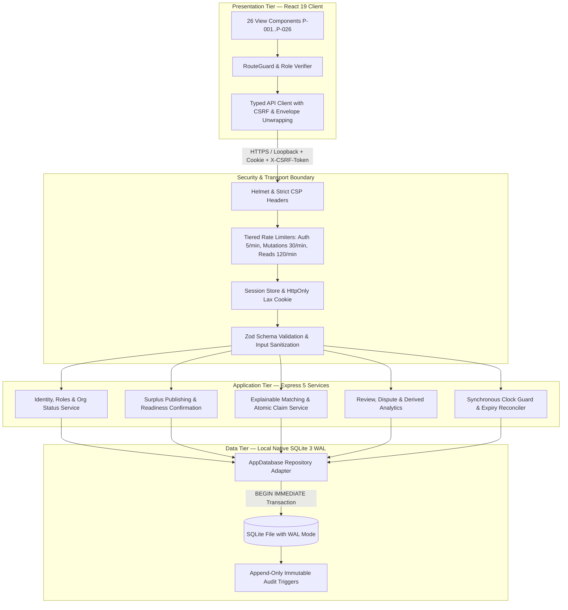

# AaharLink — System Architecture & Trust Boundaries

## Overview

AaharLink is an atomic civic food rescue logistics system engineered for high concurrency integrity, strict privacy boundaries, and verified physical handovers. It operates on a single-writer, multi-reader SQLite Write-Ahead Logging (WAL) architecture with fail-closed security enforcement.

---

## Architectural Diagram

---

## Core Trust Boundaries & Invariants

1. **Client Isolation**: The client is completely untrusted. Role checks in the React frontend are strictly UX helpers to present appropriate navigation. All authorization, ownership, and role gates are resolved on fresh database queries on the server.
2. **Atomic Exclusive Concurrency**:
   - SQLite `BEGIN IMMEDIATE` transactions ensure single-writer serialized claims.
   - Unique active claim index prevents split or over-subscribed allocations of food batches.
   - When two NGOs attempt to claim the same listing simultaneously, the first to commit receives `201 Created` with contact details unlocked. The competitor receives an immediate `409 Conflict` with zero contact details.
3. **Contact Redaction Pipeline**:
   - Unclaimed donations reveal only broad geographic vicinity and portion counts.
   - Exact physical address, contact telephone, and pickup instructions are strictly redacted until an authorized claim is committed.
4. **Physical Handover Cryptography**:
   - One-time pickup codes are generated via `crypto.randomInt(100000, 999999)`.
   - The code hash is stored using HMAC-SHA256 with a server secret.
   - Verification evaluates via `crypto.timingSafeEqual` with a 3-attempt brute-force threshold.
5. **Data Integrity & Immutability**:
   - Completed rescues cannot be modified or reversed.
   - Platform analytics compute strictly from committed database rows; no simulated or vanity multipliers.
